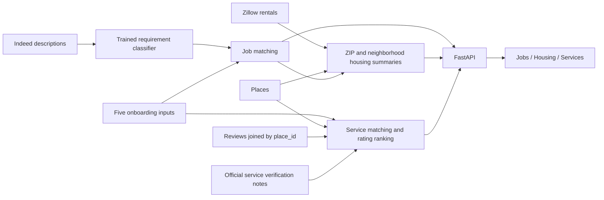

# Phoenix — Datathon Development Plan

A reentry discovery platform helping people find relevant jobs, neighborhood housing options, and highly rated public or community services.

**Track:** Advanced Track, 8th Annual Datathon for Social Good.

**Team:** Four people.

**Planning deadline:** Sunday, November 15, 2026, 2:00 PM Pacific, from the original team plan. The official guide does not state this deadline; confirm with organizers. Target submission by 1:00 PM.

**Status:** Proposed implementation. Dataset READMEs have been reviewed; raw CSV coverage, model results, service eligibility, and current availability have not yet been validated.

## 1. Feasibility and scope

**The four-dataset concept is plausible.** The READMEs explicitly support Places–Reviews joins by `place_id`, Indeed–Zillow comparisons by city, and Zillow–Places proximity calculations using coordinates. Keep one trained job-requirement NLP model and use observed ratings plus source-backed review evidence for service discovery. A second trained model is unnecessary for the MVP.

Three boundaries shape the implementation:

- The Places dataset contains essential-service businesses and organizations. A category such as clinic, grocery store, or bank does not establish public ownership, free access, reentry support, or program eligibility. Public/community-service results need a small curated verification layer based on official provider pages. Other places must be labeled as essential services with eligibility/cost unknown.
- The four READMEs do not document structured age-eligibility fields. Age can personalize a service referral only when an official source supplies an applicable age criterion. It will not rank jobs or housing.
- The Zillow README directs teams to present results at ZIP/neighborhood level and avoid publishing street addresses. Phoenix will show neighborhood rental options, rent ranges, and housing–service comparisons; it will not publish property street addresses or resident information. This supports housing discovery, but not a verified, live property application service.

The MVP is one five-question form followed by three result tabs: **Jobs**, **Housing**, and **Services**. The selected immediate need opens first. A short next-steps checklist is secondary to the three discovery functions. Start in Oakland and nearby East Bay cities, expanding only if data is sparse.

## 2. Dataset READMEs and confirmed support

Descriptions and counts in this table come from the source READMEs, not a new audit of the raw files.

| Dataset | Fields and documented coverage | Phoenix use | Important limitation |
| --- | --- | --- | --- |
| [Indeed Jobs README](https://docs.google.com/document/d/1vHDi0CcYBoAka0RoZ0Pql3z3A-NLRZkMYcChYlshpNA/edit) | About 100,000 Bay Area postings since 2024; `jobid`, `url`, `job_title`, `company_name`, `location`, `date_posted`, salary text/ranges, `job_type`, `description_text`, optional qualifications | Job recommendations; NLP training and inference; advertised pay scenarios | README explicitly says to check actual column names. Salary is missing in some postings; requirements live in description text; reposts need deduplication. No reliable fair-chance hiring or applicant acceptance label is documented. |
| [Zillow Housing README](https://docs.google.com/document/d/1lEl_Ow_tBFHTdVf_r0hVpy2Hw5OdBb83BL2zZPPWl48/edit) | About 148,000 properties; `zpid`, `city`, `county`, `zipcode`, `latitude`, `longitude`, `homeStatus`, `price`, `rentZestimate`, beds/baths; sale, rental, and sold records | Rental cost summaries by neighborhood/ZIP; compare with job income; nearby services | `FOR_RENT` price is described as likely monthly rent and needs checking. `rentZestimate` is an estimate, not an available listing. Present housing at ZIP/neighborhood level without street addresses. |
| [Google Maps Places README](https://docs.google.com/document/d/1x0B0n9C33Sj3gKMjUNYDG86pBUztC5K_o308Fe0udY0/edit) | About 100,000 essential-service places; `place_id`, `name`, `category`, `all_categories`, `address`, `lat`, `lon`, `rating`, `reviews_count`, hours/contact fields, closure flags, nested service details | Find relevant services; rank highly rated options; provide contact links; measure proximity to housing | Categories are keyword-selected and can be off-topic. Hours are only about 53% filled. Both private and public/community providers may appear. Coordinates are documented as complete. |
| [Google Maps Reviews README](https://docs.google.com/document/d/1fvKPe99FpkOu7xNKni23rYDrm4q2eTv7eQAKa9YBJjo/edit) | About 100,000 randomly sampled reviews; `place_id`, `review`, `review_rating`, `review_date`, overall place rating/count fields | Enrich matched service cards with sampled-review distributions and short, manually checked evidence about user experience | Categories are about 95% empty, so obtain categories from Places. Review text is documented as about 89% filled despite text-based source filtering. Ratings are skewed, and not every service will have matching reviews. Never display reviewer names, profiles, or URLs. |

The Places folder's `Google maps reviews_sample.csv` is a review preview, not a Places sample. Use the actual `google_maps.csv` for service records. Indeed and Zillow have sample CSVs; use them for schema inspection, not as proof of full geographic or rental coverage.

The listed full exports are large: Indeed is roughly 2.15 GB; Zillow is split across three parts totaling roughly 7.44 GB; Places roughly 506 MB; Reviews roughly 222 MB. Read selected columns in chunks and save a small target-area Parquet subset. Do not load every nested JSON field into memory or commit raw exports to GitHub.

## 3. Minimal onboarding: five inputs on one screen

| Input | User-facing question | Format | How it affects results |
| --- | --- | --- | --- |
| Age | How old are you? | Age in years, with Skip/Prefer not to say | Check only verified service age criteria. Unknown criteria produce an eligibility-to-confirm note; age does not change job/housing rankings. |
| Location | Where will you be living? | City or ZIP | Candidate jobs, housing area, and nearby services. City/ZIP input does not establish an exact home location. |
| Immediate need | What do you need help with first? | One priority: work, housing, food, health care, transportation, community support | Open the relevant results tab first and prioritize mapped service categories/checklist actions. |
| Experience | What work have you done or skills have you learned? | Skill/work-area selections plus optional short text and approximate years; No experience yet allowed | Semantic job relevance and comparison with explicit experience requirements. Include work/training completed during incarceration. |
| Education | What education or qualifications do you have? | Highest education level; optional certificates/licenses in the same input group; Not sure allowed | Compare with stated job requirements. Unanswered credentials remain unknown. |

Only location and immediate need are required to produce initial results. Allow other answers to be skipped, and show where missing information limits matching. No conviction details, prison ID, Social Security number, exact address, or account are needed.

Do not infer an actual housing budget from age, education, or experience. Initially show nearby rental costs; after a user selects a job, show a clearly labeled hypothetical income/rent comparison. Optional budget, household size, work schedule, or transport filters can be added on the results page later.

## 4. What each result contains

| Tab | Required card contents | Personalization |
| --- | --- | --- |
| Jobs | Title, employer, city, posted date, advertised pay or unknown, requirements with evidence, match/gap explanation, original posting URL where available | Location, experience, education/credentials; no age-based score |
| Housing | ZIP/neighborhood, count of usable rental records, median/range of listed monthly rent, property-type/bedroom filters where available, nearby relevant service summaries | Location and selected job's income scenario. No property street addresses or exact property map pins. Use ZIP/city summaries if neighborhood boundaries are unavailable. |
| Services | Name, mapped need category, public/community verification status, overall rating and review count, approximate distance, closure/hours status, contact/provider link, sampled-review evidence if available | Immediate need and location; age criteria only when verified from an official source |

Every result needs source/snapshot information where available and a prompt to confirm current availability. Posted dates and review dates do not establish the date the whole dataset was collected. Never invent a snapshot date.

## 5. Data pipeline and joins

1. Inspect each README and raw CSV header. Record source files/checksums, encoding, field mappings, missingness, duplicates, date coverage, and retained counts in `docs/data_decisions.md`.
2. **Indeed:** normalize city strings; preserve IDs/URLs/dates; group exact and near-duplicate postings; parse salary amount/range/period explicitly. Hourly pay may be annualized at 40 hours/week × 52 weeks/year only as a visible assumption, not guaranteed earnings. Keep salary-missing postings for matching; affordability stays unknown.
3. **Zillow:** read all relevant parts with selected columns; deduplicate by `zpid`; isolate `homeStatus == FOR_RENT`; verify rent units against source records before using `price`. Keep estimates separate from listed rents and exclude ambiguous values. Produce aggregated ZIP/city rental summaries and service-access summaries. Use a small-cell suppression rule for detailed housing features so a one-property group is not presented as an anonymous neighborhood statistic.
4. **Places:** normalize closure booleans and category tags; remove confirmed permanently closed places from active recommendations and mark/withhold temporarily closed ones. Unknown closure status stays unknown. Map `category` plus `all_categories` to a small reviewed service taxonomy. Spot-check off-topic matches.
5. **Reviews:** remove duplicate reviews where identifiable; preserve missing text as missing; join categories from deduplicated Places on `place_id`. Use a left join from service candidates so a lack of sampled reviews does not erase a useful service. Aggregate review rows by place before joining to service cards to avoid duplicate recommendations.
6. **Housing ↔ services:** use internal property and service coordinates for straight-line proximity calculations, then publish aggregate ZIP/neighborhood results. Do not publish raw property coordinates. For onboarding location, resolve a city/ZIP representative point from a documented lookup or validated area records; label distance as approximate distance from the area center, not the user's home. Fall back to city-only matching if a ZIP cannot be resolved. A distance is not a walking/transit route time.
7. **Jobs ↔ housing:** compare normalized cities or documented nearby-city rules. Indeed's README documents city text, not job coordinates; do not invent precise worksite distances or commute times. If Caden supplies additional job-location data, validate that it identifies the actual worksite and record its source/precision before using it for distance comparisons. Company headquarters and city centroids are not precise worksite locations.
8. Add a small manually curated `service_verification.csv` keyed by `place_id`: provider type, relevant service, official URL, verified age criteria if any, cost/eligibility notes, service area, and check date. Unknown fields stay unknown. Publicly listed contact details are distinct from private housing addresses.

**First-hour feasibility gate:** count jobs with usable descriptions, jobs with interpretable pay, actual rental rows, relevant Places, and Places–Reviews match rate in the target area. Count how many relevant services can be verified as public/community providers. The READMEs establish join keys, but not sufficient overlap. If Oakland is sparse, broaden to nearby cities and document it. If rental rows remain sparse, show insufficient-listing coverage and a separately labeled estimate view; estimates must not masquerade as available rentals.

## 6. Service selection and rating logic

Use **need relevance → geographic/service-area compatibility → availability/eligibility evidence → rating and distance**. A highly rated business that does not provide the needed service is not a useful recommendation.

- Map food needs to reviewed food-bank/pantry/community-meal candidates, housing support to shelters/housing-assistance candidates, health to appropriate clinics/community providers, and transport to transit resources. Exact tags and coverage require raw-data inspection. Grocery stores and banks may be shown as ordinary essential services; do not describe them as free assistance.
- For the main Highly rated view, start with an adjustable design threshold of `rating >= 4.0` and `reviews_count >= 10`, using Places overall values. These are product assumptions, not measured optimal cutoffs. Show the original score/count prominently.
- Within relevant candidates, use a count-aware ranking score such as `(n*r + m*C)/(n+m)`, where `r` is the overall rating, `n` its overall count, `C` the mean for the same service family, and `m=10` an initial prior weight. Document the settings and check ranking sensitivity. Break close ties by approximate distance, or allow a Nearest sort.
- Do not add sampled Reviews counts to Places `reviews_count`; they describe overlapping evidence. Do not replace an overall rating with the mean of a few sampled reviews. Deduplicate repeated overall rating/count fields from review rows and preserve source provenance if Places values are missing or conflict.
- Show sampled-review count, date range, star distribution, and short text evidence separately. For a small demo set, manually select/check snippets about access, cost, wait time, or staff. Automated keyword tags are only candidate retrieval; they do not establish sentiment or a factual claim. Attribute observations as reviewer reports. Strip reviewer identities and personal details from any displayed snippet.
- If too few highly rated candidates exist, explicitly say so and offer Nearby alternatives or Limited review evidence. Do not silently relax the threshold, hide all low-review-count services, or describe unrated services as poor quality. A matched place with no review text can still appear using its overall rating.
- A Google rating is an experience signal, not proof of clinical quality, safety, free service, suitability for reentry, or current capacity. For urgent housing/basic needs, also make relevant nearby verified support accessible regardless of rating evidence.

Age affects only published, source-checked service criteria. If no such criteria exist, show Eligibility needs confirmation. Do not infer eligibility from a provider name or a review. The four datasets do not support a general age-based eligibility engine.

## 7. NLP model: job requirement detection

Keep the primary trained model from the original plan: a multilabel classifier reading Indeed `description_text`. The user's onboarding answers are inputs to matching, not training labels. The model does not predict employability, employer acceptance of formerly incarcerated people, housing approval, or service eligibility.

Start with three labels:

| Label | Positive annotation | Negative annotation |
| --- | --- | --- |
| `education_required` | Explicit required diploma/degree/education criterion | Only preferred, explicitly unnecessary, or unmentioned |
| `experience_required` | Explicit required prior work experience | Only preferred, explicitly unnecessary, or unmentioned |
| `certification_required` | Explicit required professional license or certificate | Only preferred, explicitly unnecessary, or unmentioned |

Zero means no explicit requirement found in the description, not proof that the employer has none. Record quoted evidence for positive labels and note negation, alternative qualifications, and ambiguous wording. Resolve uncertainty before finalizing binary labels. A statement such as degree OR equivalent experience must follow an agreed annotation rule; do not label each alternative as individually mandatory without qualification.

Store `job_id`, description, three labels, per-label evidence spans, annotator, review notes, duplicate group, and job family. Pilot 15–20 postings together, then target 200–300 usable unique postings across logistics/warehouse, retail/customer service, and food service/hospitality. Choose alternatives before splitting if those groups lack coverage. Everyone contributes a small labeling batch; double-label about 20% and record disagreement resolution.

**Presence is not exact-value extraction.** A label cannot identify high school versus bachelor's or one year versus five years. Use separate, documented evidence-backed rules to extract exact degree/years/credentials where unambiguous; otherwise display unknown and the source text. Validate those rules manually. Do not disqualify users solely on predicted labels.

### Training, comparison, and leakage controls

1. Deduplicate/group templates, then freeze roughly 60% train, 20% validation, 20% test with a recorded seed and posting-ID manifest. Keep duplicate groups and all chunks from a posting in one partition. Record employer overlap as a remaining risk.
2. Inspect class/subgroup support before freezing. Aim for at least 15 test postings per subgroup and both positive/negative examples for each trainable label; if data is insufficient, collect more labels or narrow the task before evaluating. Disclose sparse test labels and small subgroup uncertainty.
3. Train a per-label constant majority sanity baseline and a TF-IDF + one-vs-rest logistic regression baseline, fitting vocabulary and classifiers on training data only.
4. Encode descriptions using [MiniLM](https://huggingface.co/sentence-transformers/all-MiniLM-L6-v2), then fit one-vs-rest logistic regression on the training embeddings/labels. Training the classifier is the supervised learning step; generating frozen embeddings alone is not enough.
5. MiniLM's model card states default truncation beyond 256 word pieces. Use sentence-aware chunks within the model limit and a documented posting-level aggregation method. Select settings, thresholds, and the final model using validation data only.
6. Optional [SetFit multilabel fine-tuning](https://huggingface.co/docs/setfit/how_to/multilabel) comes only after required evaluation and integration work. Smoke-test hardware first; 32 GB RAM is not a training-duration guarantee.
7. Lock decisions before final test evaluation. Report real results even if TF-IDF wins. Do not use test failures to tune and then re-report the same test as untouched.

## 8. Evaluation, fairness, and data audits

For every required model, use identical final-test posting IDs and report macro-F1, micro-F1, per-label precision/recall/F1, support, thresholds, and how undefined metrics are handled. No illustrative scores may appear as measured findings.

**Required subgroup analysis:** compare at least three prespecified meaningful job families. For each, show test count, label support/prevalence, overall metrics, per-label recall, false-negative rates, and false-positive rates where defined. Compare baseline and candidate. Mark undefined metrics explicitly. Job-family comparisons reveal uneven model performance; they do not establish demographic fairness, and age-based model fairness cannot be validated without appropriate ground truth.

Manually inspect at least five model failures across multiple groups/labels, covering false positives and false negatives where available. Record ID, subgroup, gold/predicted labels, score, source evidence, likely cause, product consequence, and mitigation. Consider negation, preferred-versus-required language, alternative qualifications, and lost context. False positives can discourage applications; false negatives can hide qualification gaps. Show source evidence and confirmation steps.

Person 4 independently audits at least 20 jobs, 20 housing records, 20 service candidates, 20 matched review rows, and 10 geographic pairings where available; inspect all if fewer exist. Check salary/rent units, duplicate keys, category relevance, closure flags, public/community claims, age notes, review attachment, missing ratings, and housing-address suppression. Save original/transformed values, reviewer, findings, and corrections in `reports/data_audit.csv`.

Check service rankings across at least three available service families: candidate coverage, missing ratings, review-join rates, and whether low-review areas lose useful services. This descriptive ranking audit complements the required model subgroup analysis; it does not replace it. Do not claim service recommendation accuracy without relevant labeled judgments.

## 9. Matching and housing calculations

### Job recommendation sequence

Use a transparent sequence of suitability, comparable pay, and proximity. Replace the previous weighted sum: its undefined score scales and 10% pay weight could allow a small location-score change to outweigh a large pay increase. Requirement extraction and text similarity inform matching; the ranking policy makes the pay/location tradeoff. Age never enters the job ranking.

1. **Check practical requirements and user constraints.** Distinguish mandatory qualifications from preferred ones, including alternative qualifications such as a degree OR equivalent experience. Record source-backed matches, confirmed gaps, and unknowns. Hard filters apply only to explicit user constraints backed by reliable data, such as a chosen search area. A predicted requirement, a preferred qualification, or missing user information must not automatically exclude a job. Show jobs with confirmed qualification gaps in a clearly labeled group rather than implying the person qualifies.
2. **Group reasonably relevant jobs by suitability.** Use the user's experience, transferable skills, education, and evidence-backed requirements. Keep strong matches, possible matches needing confirmation, and jobs with known gaps distinguishable. Document the tier rules and review them with fictional profiles; model confidence or semantic similarity alone is not proof of eligibility. Higher pay must not make an unrelated specialist job appear to be a strong match.
3. **Compare pay within the same suitability tier and pay basis.** The MVP default orders comparable advertised pay from highest to lowest, using the lower endpoint of a posted range and showing the full range. Use the same currency and pay period; prefer hourly rates when available. Convert annual/weekly pay to an hourly equivalent only when working hours are stated or a shared scenario is explicitly selected and labeled. Do not claim twice the compensation when the difference could come from twice the working hours, a one-time bonus, commission, or inconsistent units. Keep incomparable pay bases in labeled groups rather than forcing a false numeric comparison. Missing or ambiguous pay remains Pay not listed/Pay needs confirmation in a visible group within the relevant fit tier; do not assign it zero pay or call it a poor match.
4. **Use proximity as a secondary preference.** Within a fit tier, pay is the primary default ordering key and reliable distance breaks pay ties; use a stable ID for remaining ties. This makes the MVP behavior deterministic without an arbitrary dollar-per-mile conversion. Do not apply abrupt distance buckets or a hidden radius cutoff. A small distance increase must not overturn a large pay advantage unless the job violates an explicit user travel constraint. Offer Highest pay and Nearest sorting within suitability groups so the user can choose the tradeoff. Nearest requires comparable location precision and the same reference point; retain distance-unknown results in a visible group. If a later balanced score applies a distance penalty, make it gradual, document its units/settings, and validate it before replacing this default.
5. **Explain the recommendation.** Show qualification matches/gaps, advertised pay/range and conversion assumptions, location precision, and why the job is ordered ahead of alternatives. Do not imply an active vacancy, hiring guarantee, or known commute time.

Location precision is part of the ranking contract. With city-only job locations, use city/nearby-area compatibility and show precise distance as Unknown. A reliable worksite coordinate can support an approximate straight-line distance from the selected area reference point; label the reference point and measurement. City/ZIP onboarding does not establish a user's exact home, and a geographic distance is not a transit or driving time. Do not compare a city-centroid estimate with a verified worksite distance as though their precision were equal.

### Required pay-versus-distance behavior

Illustrative scenario only; assume equal suitability, comparable work schedules/pay, verified worksite locations, and a common reference point. Both jobs satisfy the user's chosen travel constraints.

| Factor | Job A | Job B |
| --- | --- | --- |
| Advertised hourly pay | $20 | $40 |
| Approximate distance | 2.0 miles | 2.5 miles |
| Experience and qualification fit | Similar | Similar |
| Default ordering within the fit tier | Second | First |

Expected explanation: Similar match to your experience, twice the advertised hourly pay, and approximately 0.5 mile farther from the selected reference point. Under Nearest sorting, Job A can appear first, with the pay tradeoff still visible. If the location data is only city-level, omit the mileage claim and explain the pay advantage using the available location information.

### Ranking acceptance checks

- Holding suitability, hours, pay basis, and location constant, increasing advertised pay never lowers a job's default rank within its group.
- The $40/hour, 2.5-mile job outranks the $20/hour, 2-mile job under the example's assumptions; a small distance change cannot create an abrupt default-score drop.
- An explicit travel limit can remove an otherwise attractive job only when reliable location data supports that decision. Unknown distance is flagged, not treated as outside the limit.
- $40,000/year for 20 hours/week is not described as half the hourly pay of $80,000/year for 40 hours/week under equal working-week assumptions. Advertised hours and actual earnings scenarios remain visible.
- Missing pay, missing location, skipped qualifications, and preferred-versus-required wording do not become fabricated values or automatic disqualifications. Strong pay cannot erase a confirmed qualification gap.
- Pay ranges use the same endpoint policy, geographic comparisons use the same reference/precision, sorting is deterministic, and explanations agree with the actual ordering. Record manually reviewed fixtures and outcomes alongside the data audit; these checks validate the ranking policy, not real-world hiring success.

### Housing calculations

For a selected job and a rental-cost summary:

`rent_burden = 12 * monthly_rent / annual_gross_pay`

`12 * $1,200 / $48,000 = 30%`

Salary ranges produce a burden interval. Missing/invalid pay or rent produces Unknown, not zero. State work-hours assumptions and distinguish a selected job's hypothetical income from the user's current income. The calculation excludes taxes, deposits, utilities, household needs, and variable hours; it does not establish affordability or rental eligibility. No age-based housing score is used.

Only show a 30-day checklist if the three discovery tabs work. Use deterministic next-step templates: confirm job requirements, contact a provider, check published eligibility, and explore rental costs. A chatbot or generative plan is unnecessary.

## 10. Architecture and shared contract

Use Next.js/React/Tailwind for the interface; FastAPI for the API; pandas plus Parquet for selected clean data; scikit-learn and Sentence Transformers for NLP. Precompute model outputs and service-review aggregates. Use a spatial index for service proximity and avoid an expensive whole-dataset Cartesian join. Deployment is optional under the event guide; prioritize a reliable local demo and reproducible analysis.

Proposed endpoints: `GET /health`, `POST /recommendations`, and an optional `POST /housing-comparison` after selecting a job. Agree on request/response schemas and one realistic synthetic fixture before splitting work.

Request fields: `age` (nullable), `location` (city/ZIP), `priority_need`, `experience` (skills/text/optional years), and `education` (level/optional credentials).

Response sections: `jobs`, `housing_areas`, `services`, `data_coverage`, and `next_steps`. Include stable IDs, source fields, match explanations, uncertainty, and nullable missing values. Jobs need suitability tier, requirement evidence/gaps/unknowns, pay range/period/currency and conversion basis, stated or assumed hours, location source/precision, nullable distance and its reference point, active sort mode, and ranking explanation. Services need overall rating/count separate from sampled-review count/date range, verification status, and evidence source. Housing responses must contain only publishable aggregates, not raw property addresses, IDs, or exact coordinates. The frontend must handle empty results, unknown eligibility, sparse reviews, and missing pay.

## 11. Four-person ownership and handoffs

Only Max is named in the original draft; assign names to the remaining roles at kickoff.

| Person | Ownership | First handoff | Done when |
| --- | --- | --- | --- |
| **1 — Max: data and integration** | Indeed/Zillow cleaning; salary/rent normalization; job ranking; housing summaries; spatial pairings; shared schema | Target-area samples, coverage counts, schema fixture | All four sources feed one coherent response with honest missing-data states and source provenance |
| **2 — ML teammate: NLP and evaluation** | Label guide, sample/splits, baseline/candidate training, inference artifacts, subgroup/error reports | Pilot labels and runnable baseline | Reproducible fitted model, identical-test baseline comparison, three-subgroup results, failure examples, model configuration |
| **3 — Frontend and demo** | Five-question onboarding; Jobs/Housing/Services tabs; rating/review displays; responsive/empty states; recording | Fixture-driven form and three result tabs | Complete journey works with real API output, source/uncertainty information is visible, housing privacy rule holds, video is within five minutes |
| **4 — Backend, Places/Reviews, and QA** | Places cleaning; Reviews join/aggregates; service taxonomy/verification; rating ranker; API; audits/reproduction; slide assembly | Service card fixture, review-join coverage, API stub | Useful public/community candidates are verified, service reviews attach correctly, rank settings are explicit, audits and fresh rerun are recorded, slides/links work |

All four help label a small batch after the common pilot. Person 1 hands clean descriptions/duplicate groups to Person 2; Person 2 returns per-job predictions and evidence interfaces. Person 4 shares service aggregates keyed by `place_id` and API schemas with Persons 1/3. Person 3 builds against fixtures immediately and switches to real data early. Freeze shared schemas after first integration. Use small commits on role branches if useful.

Person 2 prepares model/results slides; Person 1 prepares data/impact slides; Person 3 records the demo; Person 4 assembles the deck and checks access. Max submits the form.

## 12. Advanced Track evidence checklist

Source: [Official Tracks & Guide](https://docs.google.com/document/d/1c5KUeuk5zFuD-7_Dv4B8BS5cJQcYxjrNUEpTL26iBLw/edit?tab=t.0). Every listed technical item must be met for Advanced Track; the guide says a project missing one is judged in the Open Track. Leave boxes unchecked until artifacts exist.

| Done | Requirement | Evidence to deliver | Owner |
| --- | --- | --- | --- |
| [ ] | Use at least one provided dataset | All four sources used; file IDs/checksums, retained counts, field maps, join and geographic coverage in `docs/data_decisions.md` | Person 1; Person 4 supplies Places/Reviews |
| [ ] | Train or fine-tune a predictive/NLP model | Fitted requirement classifier; labels, training code, config, artifact instructions, training log | Person 2 |
| [ ] | Compare against a simple baseline | Majority sanity baseline, TF-IDF baseline, MiniLM candidate, identical test IDs | Person 2 |
| [ ] | Appropriate metrics on held-out data unused for training/tuning | `reports/model_metrics.csv`, `reports/evaluation.md`, frozen split manifest and validation-selected settings | Person 2 |
| [ ] | Error/fairness analysis across at least three meaningful subgroups, with failures | `reports/subgroup_metrics.csv`; `reports/error_analysis.md` with at least five reviewed errors and consequences | Person 2; Person 4 reviews |
| [ ] | Explain labeling, cleaning, and joins; hand-check samples | Labeling rubric/disagreements; salary/rent rules; Places–Reviews join audit; category/eligibility checks; `reports/data_audit.csv` | Persons 1, 2, and 4 |
| [ ] | Code runs from raw inputs to reported results | Working README commands, dependency lockfile, seeds, model revision, authorized input access, output paths, fresh-environment rerun record | Person 4; Persons 1–2 supply scripts |

Judge-facing claims must distinguish job-classification metrics from recommendation usefulness, observed Google ratings from verified service suitability, and neighborhood cost scenarios from available housing. The guide does not require the complex model to outperform the baseline; report the measured result honestly.

## 13. Reproducibility and release checks

Planned paths: `src/data/`, `src/ml/`, `src/recommend/`, `backend/`, `frontend/`, `configs/`, `docs/`, `reports/`, `data/resources/service_verification.csv`, and `slides/`. Keep raw exports outside version control unless redistribution is expressly permitted; document authorized access instead.

The final README must contain exact commands that actually exist: install pinned dependencies → place documented raw files → clean/subset all four datasets → reproduce labels/split → train models → generate evaluation reports → precompute app data → start API/UI. Record file checksums, seeds, model revision, sampling/aggregation rules, expected output paths, assumptions, and any nondeterminism. Person 4 reruns raw data to reported results in a fresh environment.

Before recording, verify salary units and the 30% example; duplicate/split isolation; correct prediction joins; at least three subgroup results; review attachment by `place_id`; count-aware rating behavior; low-review fallbacks; unknown age eligibility; no reviewer identities or property addresses in public responses; and the full form → API → three result tabs journey. Check project/deck/video links signed out.

## 14. Schedule and scope cuts

All times are Pacific. Saturday uses time relative to kickoff; Sunday targets remain fixed pending organizer confirmation.

| Gate | Required outcome |
| --- | --- |
| Saturday T+0–30 min | Assign owners, freeze five-input/schema fixture, agree need taxonomy and label rubric |
| T+30–90 min | Confirm raw field mappings, target-area rentals/jobs/services, Reviews join rate, and available public/community candidates; label pilot |
| T+90 min–3 h | Parallel cleaning/aggregation, labeling and baseline training, fixture-driven frontend, service verification |
| T+3–5 h | Train candidate; serve real data; connect three tabs; review service ratings and housing aggregation |
| Saturday end-of-build | One complete user journey; fitted model saved; subgroup support confirmed; audits and README underway |
| Sunday 9–10 AM | Lock settings; final test/subgroup/error reports; fresh-environment rerun; fix material data issues |
| 10–11 AM | Results/data/impact slides; final UI fixes; rehearsal |
| 11 AM–noon | Record a video targeting 4:45; assemble deck; verify claims and metrics |
| Noon–1 PM | Check links and checklist; Max submits form and saves confirmation |
| 1–2 PM | Submission buffer; fix only blockers |

Cut order: interactive map/chat/accounts → SetFit/extra labels → extended checklist → additional cities → visual polish. Preserve all four source integrations, five-input form, three discovery tabs, required Advanced evidence, slides, and video. If deployment fails, submit the accessible repository and recorded local demo. If a source lacks usable coverage, disclose the limitation rather than fabricate results.

## 15. Submission checklist and video

| Done | Required deliverable | Owner |
| --- | --- | --- |
| [ ] | Accessible project URL: public repository, runnable notebook, or deployed app, with reproducible analysis | Person 4 |
| [ ] | Slideshow explaining problem, data, methods, findings, impact, subgroup failures, and limitations | Person 4 coordinates; all contribute |
| [ ] | Playable video of at most five minutes, with accessible sharing permissions | Person 3 records; Person 4 verifies |
| [ ] | One team member submits the official form and saves confirmation | Max |

[Official form linked in the event guide](https://docs.google.com/forms/d/e/1FAIpQLSfWHAXrGLYZztTQ5lHI_GlY72-hW9zT1yps0FI2gxVkdRs7ag/viewform).

Suggested video: 0:00–0:30 problem and fictional user; 0:30–1:50 five-input form and three-tab demo; 1:50–2:35 four datasets and trained NLP; 2:35–3:20 baseline/test results; 3:20–4:10 subgroup failures and limitations; 4:10–4:45 social good value, reproducibility, next steps. Avoid unsupported claims about hiring success, housing approval, service safety, or reduced recidivism.

## Verification boundary

All four linked READMEs and the official event guide were read directly. Counts, field descriptions, missingness notes, source restrictions, and documented join keys above reflect those documents. Raw CSV headers/rows, actual target-area coverage, join success, present-day service availability, official age criteria, model performance, and organizer deadline still require the explicit implementation checks assigned in this plan. This document replaces `SECOND_CHANCE_PLAN.md`.
