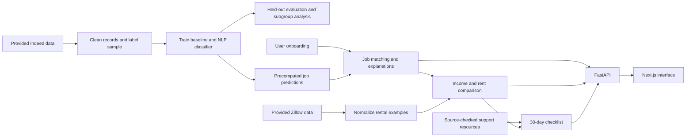

# Second Chance — Datathon Development Plan

A personalized reentry planning prototype connecting employment, housing costs, and community support.

**Target:** Advanced Track, 8th Annual Datathon for Social Good, November 14–15, 2026.  
**Planning deadline:** Sunday, November 15 at 2:00 PM Pacific, supplied in the original team plan. The linked guide does not state this deadline; confirm it with the organizers. Aim to submit by 1:00 PM.  
**Status:** Development plan. Models, metrics, resources, and product functionality described below are planned deliverables, not completed results.

## 1. Assessment and changes to the original plan

**Verdict: a strong fit, provided the team prioritizes the Advanced Track evidence over extra product features.** The guide permits a team-defined social good cause, requires at least one provided dataset, and explicitly suggests job-posting NLP and comparisons of pay with rent. Second Chance combines those ideas around a clear user need.

The strongest feature is the connection between job income and housing costs. The main execution risk is building three polished pages while leaving the model evaluation incomplete. A working model, honest findings, and a small usable demo are more valuable than a larger unfinished app.

Changes from the original draft:

- Add the missing **error and fairness analysis across at least three meaningful subgroups**, with failure examples.
- Reserve a test set that is never used for training, threshold selection, or model selection.
- Add a labeling guide, hand audits of cleaning and geographic pairing, and raw-data-to-results instructions.
- Make the mandatory slide deck, project link, and video of at most five minutes explicit deliverables.
- Correct the affordability example: $1,200 monthly rent on $48,000 annual gross pay is **30%**, not 3%.
- Separate predicted requirement presence from extraction of exact degrees, years, and credentials. A binary classifier cannot supply those details by itself.
- Treat the provided postings and properties as dataset snapshots; availability and eligibility require confirmation.
- Limit the MVP to Oakland and nearby cities with sufficient data. Defer maps, chat, accounts, and optional fine-tuning until the required evidence is complete.

## 2. Official requirements and evidence checklist

Source: [2026 Datathon Tracks & Guide](https://docs.google.com/document/d/1c5KUeuk5zFuD-7_Dv4B8BS5cJQcYxjrNUEpTL26iBLw/edit?tab=t.0), reviewed November 14, 2026. The guide says projects missing an Advanced requirement are judged in the Open Track. It also uses “Beginner Track” elsewhere; follow the organizers' submission form for the final track label.

These boxes remain unchecked until the evidence exists. Planned paths are targets to create during development.

| Done | Requirement from guide | Planned evidence / completion condition | Accountable owner |
| --- | --- | --- | --- |
| [ ] | Use at least one provided dataset | Indeed supplies labeled descriptions and recommendations; Zillow supplies rental comparisons. `docs/data_decisions.md` identifies source files, versions/checksums, row counts, and actual retained coverage. | Person 1 |
| [ ] | Train or fine-tune a predictive or NLP model | Train a multilabel classifier on team-labeled Indeed descriptions. Save training code, labels, configuration, model artifact instructions, and training log. Frozen embeddings alone do not satisfy this plan: the supervised classifier must be fitted. | Person 2 |
| [ ] | Compare the model with a simple baseline | Evaluate TF-IDF + one-vs-rest logistic regression and MiniLM embeddings + a trained multilabel classifier on the same held-out postings. Include a per-label constant majority baseline as a sanity check. | Person 2 |
| [ ] | Report appropriate metrics on an untouched held-out test set | `reports/model_metrics.csv` and `reports/evaluation.md`: macro-F1, micro-F1, per-label precision/recall/F1/support, split sizes, and fixed validation-selected thresholds. | Person 2 |
| [ ] | Error and fairness analysis across at least three meaningful subgroups, plus failures | `reports/subgroup_metrics.csv` compares at least three prespecified job families with sample counts and relevant errors. `reports/error_analysis.md` shows at least five manually reviewed failures and their product consequences. | Person 2; Person 4 reviews |
| [ ] | Explain labeling, substantial cleaning, and dataset joins; check a sample by hand | Label definitions, disagreement review, cleaning counts, salary/rent unit checks, and a manual audit of geographic pairings in `docs/data_decisions.md` and `reports/data_audit.csv`. | Person 1; Person 4 audits |
| [ ] | Share code running from raw data to reported results | `README.md` contains exact working setup/run commands, permitted raw-data access steps, expected paths, pinned dependencies, seeds, model revision, and output locations. Person 4 reruns the pipeline in a fresh environment. | Person 4; Persons 1–2 supply scripts |

The guide then scores technical depth, social good impact, and presentation. Show how model outputs change the user's recommendations, explain the limits of the available data, and present actual measured results even if the simpler model wins. The guide does not require beating the baseline.

### Required submission components

| Done | Deliverable | Completion condition | Owner |
| --- | --- | --- | --- |
| [ ] | Project link | Public repository or another accessible project URL; reproducible analysis available even if deployment fails. Check links while signed out. | Person 4 |
| [ ] | Slideshow presentation | Deck covers the problem, datasets, methodology, findings, subgroup errors, limitations, and social good impact. | Person 4 coordinates; all contribute |
| [ ] | Video overview | Playable video of no more than five minutes that walks through the project and presentation. Verify runtime and sharing access. | Person 3 records; Person 4 checks |
| [ ] | Submission form | One team member submits all required links through the official form and saves confirmation. | Max / Person 1 |

[Official submission form linked in the guide](https://docs.google.com/forms/d/e/1FAIpQLSfWHAXrGLYZztTQ5lHI_GlY72-hW9zT1yps0FI2gxVkdRs7ag/viewform).

## 3. MVP and user journey

**User:** a fictional person returning to the Oakland area who wants to identify possible jobs, understand housing costs, and organize next steps. No claim of consultation with actual reentry participants is implied.

1. Collect location, skills, education/certifications, desired work schedule, budget, and immediate support needs. Allow unanswered fields.
2. Return a small ranked job shortlist with advertised pay when available, requirement indicators, original text evidence, and explanations.
3. Pair jobs with relevant rental examples by geography and compare rent with gross earnings. Explain when no viable pair is found.
4. Produce a deterministic 30-day checklist using the user's stated priorities and source-linked resource entries.

| Priority | Deliverable |
| --- | --- |
| P0 | Simple onboarding, job results, housing comparison, action checklist, and visible uncertainty/source information |
| P0 | Trained model, baseline comparison, held-out evaluation, three-subgroup analysis, error examples, data audit, reproducible scripts |
| P0 | README, slides, five-minute maximum video, and completed submission |
| P1 | Separate resource detail view, saved checklist during the current session, additional cities |
| P2 | Interactive map, generative chat, accounts, persistent profiles, advanced routing, SetFit experiments |

Use a handful of manually source-checked reentry organizations. Prioritize immediate support referrals before presenting market-rate rentals as longer-term possibilities. Distinguish a directory listing from confirmation that a service currently has capacity.

## 4. Four-person work split

Only Max is named in the supplied draft. Replace the other role labels with teammate names at kickoff.

| Person | Primary ownership and suggested paths | First independent deliverable | Definition of done |
| --- | --- | --- | --- |
| **1 — Max: data, matching, integration** | `src/data/`, `src/recommend/`, data schemas, salary normalization, rent comparisons, data-decision notes | Clean sample records, field mapping, and a shared response fixture within the first hour | Pipeline preserves provenance, pairs by geography without pretending to share an entity ID, handles missing pay/rent, passes calculation checks, and drives the demo |
| **2 — ML teammate, 32 GB machine: labels, training, evaluation** | `src/ml/`, `configs/`, label guide, split manifest, model artifacts, all model/error/subgroup reports | Label definitions, a frozen split plan, and a runnable baseline | Trained candidate plus baseline metrics on identical test IDs; three meaningful subgroup results; failure examples; saved configuration and reproducible inference |
| **3 — Frontend and demo** | `frontend/`, onboarding, opportunity cards, checklist, responsive states, demo recording | Three screens connected to the shared fixture, independent of backend availability | Full journey works with the real API; unknown values, empty results, snapshot dates, and failed requests display clearly; records a video within the runtime limit |
| **4 — Backend, resources, QA, submission assets** | `backend/`, `data/resources/`, API schema, resource provenance, audit/reproduction checks, `slides/` | API serving the shared fixture plus a source-linked resource template | API serves real pipeline output; resource fields are checked; audit and fresh-environment rerun are documented; slides and submission links are accessible |

### Shared work and handoffs

- **First 30 minutes:** all four agree on geography, labels, schema, folder ownership, and dependencies. Person 2 defines the labeling rubric; everyone labels a small batch while Person 2 resolves ambiguity.
- **Labeling:** Persons 1, 3, and 4 each contribute roughly 40–60 postings; Person 2 labels the remainder and reviews disagreements. Timebox everyone's contribution to preserve parallel development. Target 200–300 usable examples first, expanding toward 400 only if time and coverage permit.
- **Person 1 → Person 2:** cleaned descriptions with stable IDs, duplicate-group IDs, and job-family metadata.
- **Person 2 → Persons 1 and 4:** predictions keyed by job ID, model version, label definitions, confidence/decision scores, and an inference interface. Exact requirement values need separate evidence extraction.
- **Person 1 → Persons 3 and 4:** normalized job/housing records, pairing output, and rank explanations.
- **Person 4 → Person 3:** fixture immediately, then real endpoints with the same schema. Switch to real data early on Saturday.
- **Sunday:** Person 2 owns results slides, Person 1 owns data/impact slides, Person 3 owns demo capture, and Person 4 assembles the deck. Max submits.

Use small commits and role branches such as `codex/data`, `codex/ml`, `codex/frontend`, and `codex/backend` if helpful. Person 1 coordinates integration; each owner resolves issues in their area. Freeze schema changes after the first working integration unless all affected owners agree.

## 5. Architecture and integration contract

Use Next.js/React/Tailwind for the interface, FastAPI for serving results, pandas for cleaning, and scikit-learn for training/evaluation. Store processed data and precomputed predictions in Parquet/JSON or SQLite. Choose deployment only after the local end-to-end flow works; a deployed site is optional under the guide.



Proposed endpoints: `GET /health`, `POST /recommendations`, and `GET /resources`. Return recommendations, housing comparisons, and checklist steps together from the POST endpoint to keep integration simple. Define typed request/response models in `backend/schemas.py` and share a JSON fixture with the frontend.

Example job response fragment, with illustrative values:

```json
{
  "job_id": "example_001",
  "title": "Warehouse Associate",
  "city": "Oakland",
  "annual_gross_pay_low": 48000,
  "annual_gross_pay_high": 52000,
  "pay_source": "advertised",
  "assumed_hours_per_week": 40,
  "assumed_weeks_per_year": 52,
  "skill_similarity": 0.86,
  "requirement_predictions": {
    "education_required": true,
    "experience_required": true,
    "certification_required": false
  },
  "extracted_requirements": {
    "education": "high_school",
    "experience_years": 1,
    "evidence": ["High school diploma and one year of warehouse experience required."]
  },
  "model_version": "placeholder-not-trained",
  "source_url": null,
  "snapshot_date": null,
  "needs_confirmation": ["Current availability", "Employer-specific eligibility"]
}
```

Use `null` for unknown exact values and missing metadata. A negative model prediction means the model did not detect a requirement; it does not establish that the requirement is absent. Preserve original text alongside predictions. Prediction scores are not probabilities unless calibration is separately evaluated.

## 6. Data processing, pairing, and manual checks

The guide describes approximately 100,000 Indeed postings and 148,000 Zillow property records. These are source-level estimates, not counts of usable Oakland jobs or rentals. Actual column names, data coverage, timestamps, and rental status values must be checked against the dataset READMEs and files before implementation.

### Indeed

Map available fields for job ID, title, employer, city, description, pay amount/range/period, job type, and source date/URL. Preserve original values.

1. Inspect source README and sample records; record missingness and retained counts at each step.
2. Normalize cities and create stable IDs. Group exact/near-duplicate postings before splitting to prevent copies leaking into evaluation.
3. Parse pay periods explicitly. Annualize hourly pay using documented hours/week and weeks/year; distinguish assumptions from advertised guaranteed hours. Keep ranges and exclude ambiguous units from financial comparisons.
4. Preserve jobs without salary for skills matching, but display affordability as unknown. Do not silently impute income.
5. Limit initial embedding/inference work to the target geography; batch and cache predictions.

### Zillow

Map available fields for property ID, city/ZIP, status, rent/price, rent estimate, home type, bedrooms, coordinates, and snapshot date.

1. Inspect how the actual schema distinguishes monthly listed rents from sale prices and estimates. A candidate status such as `FOR_RENT` must be verified, not assumed.
2. Deduplicate properties; reject invalid, nonpositive, or ambiguous rental amounts.
3. Use confirmed monthly listed rent for listing comparisons. Keep `rentZestimate` as a separately labeled estimate if used in a neighborhood-cost view; it is not a listed rent or evidence of availability.
4. Pair jobs and rentals by normalized geography or documented distance rules. This is a scenario pairing, not an entity-level database join; there is no assumed shared job/property identifier.
5. Start with city compatibility. Do not present city matches or straight-line distances as transit commute times.

### Data viability gate and audit

Within the first hour, report usable jobs, jobs with interpretable pay, rental listings, and geographic overlap. If Oakland is sparse, expand to nearby East Bay cities and document the change. If rentals remain sparse, show clearly labeled city-level rent estimates where available, or an explicit “insufficient rental data” state. Preserve Indeed NLP as the core Advanced Track work.

Person 1 documents cleaning and pairing rules; Person 4 independently hand-checks at least 20 job records, 20 housing records, and 10 job–housing pairs where available. Include missing pay, hourly pay, ranges, duplicate records, sale/rent ambiguity, and city-name differences. If fewer records exist, inspect all and report the count. Save IDs, original values, transformed values, reviewer, findings, and corrections in `reports/data_audit.csv`. These are team audit targets, not organizer-specified minimum counts.

For support resources, store name, service category, official source URL, service area, contact details, access/eligibility notes if published, and date checked. A website check does not confirm current capacity. [CDCR's ARCAID](https://www.cdcr.ca.gov/rehabilitation/arcaid/) is a starting directory for reentry support, not a substitute for checking individual entries.

## 7. Model task and labeling

Train a multilabel classifier to detect explicit requirements in Indeed job descriptions. Start with three well-supported labels: education required, prior experience required, and certification/license required. Add physical demands, scheduling constraints, and training provided only if annotation quality and class coverage allow.

Define required versus preferred qualifications, negation such as “no experience required,” equivalent experience, ambiguous text, and missing descriptions. Save a short quoted evidence span for positive labels; exclude or adjudicate uncertain examples rather than forcing them into the negative class. Freeze the label set before final training.

Presence classification does not extract the exact degree level, years of experience, credential, or shift. For the MVP, show evidence text; use small separately documented extraction rules for exact values where unambiguous, otherwise return unknown. Validate exact-value extraction separately on a manual sample. Do not use predicted presence alone to exclude a user from a job.

Do not predict employer acceptance of applicants with criminal records: the datasets do not establish that outcome. Do not collect conviction details or use protected traits to rank people.

### Annotation and leakage controls

1. Prespecify three job families using title/category metadata before model evaluation: logistics/warehouse, retail/customer service, and food service/hospitality. Check coverage first; if these are not supported, choose three meaningful alternatives and document the decision before freezing the split.
2. Sample across these groups and include both positive and negative label examples. Record sampling proportions; an intentionally balanced sample is not representative of all job postings.
3. Double-label about 20% of the annotation sample. Record disagreements, revise the rubric during the pilot, and adjudicate before finalizing gold labels.
4. After deduplication, freeze approximately 60% train, 20% validation, and 20% test using a fixed seed. Keep near-duplicate/template groups in one partition; document employer overlap and remaining leakage risks. Save posting IDs and split assignment in a manifest.
5. Check label and subgroup support before freezing. Aim for at least 15 test postings per subgroup; flag sparse labels and groups. Report actual counts and uncertainty rather than treating these planning targets as proof of statistical reliability.
6. Fit TF-IDF vocabulary, classifiers, and any supervised fine-tuning only on training data. Select model settings, thresholds, and chunk aggregation on validation data. Lock them before the final test run.

### Model comparison

| Experiment | Purpose | Priority |
| --- | --- | --- |
| Constant majority prediction per label, learned from training labels | Sanity-check baseline | Required |
| TF-IDF + one-vs-rest logistic regression | Simple trained text baseline | Required |
| Frozen MiniLM embeddings + fitted one-vs-rest logistic regression | Main NLP candidate; supervised training occurs in the classifier | Required |
| SetFit multilabel fine-tuning | Optional candidate after the core comparison and subgroup reporting work | Stretch |

Use [all-MiniLM-L6-v2](https://huggingface.co/sentence-transformers/all-MiniLM-L6-v2) for embeddings. Its model card states that inputs longer than 256 word pieces are truncated by default. Split long postings into sentence-aware chunks within that limit and use a documented aggregation rule, consistently across training and inference. Retain posting-level splits; chunks from one posting must never cross partitions. Evaluate whole-posting labels, not chunks as if they were independent postings.

[SetFit supports multilabel classifiers](https://huggingface.co/docs/setfit/how_to/multilabel), but it is optional. Timebox any experiment after a short hardware smoke run; 32 GB of RAM is not a training-time guarantee. Keep a working trained baseline throughout. If the simpler model wins on validation, use it and report the result honestly.

## 8. Held-out evaluation, error analysis, and fairness

Report actual final-test results for each required model using the same posting IDs, labels, and metric definitions. Include macro-F1, micro-F1, per-label precision/recall/F1, positive and negative support, and the validation-selected decision thresholds. State how undefined metrics are handled and flag labels without sufficient support. Never insert illustrative scores into the results table as measured performance.

**The mandatory subgroup report compares at least three meaningful job families.** For each family, report number of test postings, label prevalence/support, macro/micro-F1, and per-label recall/false-negative and false-positive rates where denominators permit. Include baseline results alongside the candidate. If a metric is undefined, mark it as such rather than reporting a misleading zero. Any small subgroup must carry an explicit small-sample limitation.

Inspect at least five failures spanning more than one subgroup and label. Save job ID, subgroup, gold label, prediction/score, evidence text, likely failure reason, and proposed mitigation. Examine negation, preferred-versus-required wording, equivalent qualifications, long-posting truncation/chunking, and ambiguous credentials. Include both false positives and false negatives where present.

Explain the product consequence: a false requirement flag may discourage an applicant; a missed requirement may waste time or hide a qualification gap. Show source evidence and confirmation steps to reduce those harms. Differences across job families reveal uneven performance but do not establish demographic fairness. We have no labeled reentry hiring outcomes and cannot validate hiring success, housing approval, or reduced recidivism.

Choose the final model using validation only. Use the final test set for reporting and error analysis after decisions are locked. If a test failure inspires a later model change, evaluate that change on a newly untouched test set or report it as exploratory; do not reuse the original test set for tuning.

## 9. Job ranking and housing comparison

Begin with the original transparent design assumption:

`score = 0.45 * skills + 0.25 * qualifications + 0.20 * location + 0.10 * pay`

Normalize all components to [0, 1] and document transformations, missing-value handling, and weights. Apply a recorded neutral score to missing pay/qualification components instead of silently treating missing information as failure; expose the unknown fields. These weights are not learned or validated. Check rankings manually on several fictional profiles; do not present classifier F1 as proof that the ranking helps real users.

Use confirmed, explicit constraints for hard filters, such as a user-selected location. Offer qualification-gap explanations when requirements are uncertain. Predicting a requirement is not proof that the user is ineligible; do not automatically disqualify users on a classifier output.

`rent_burden = 12 * monthly_rent / annual_gross_pay`

Example: `12 * 1200 / 48000 = 0.30 = 30%`. For salary ranges, show a burden interval and use the lower advertised pay endpoint for a conservative scenario. Return unknown for missing/nonpositive pay or missing/invalid rent. Show assumptions about work hours explicitly.

The 30% marker is an illustrative reference for the prototype, not an assessment of eligibility or disposable income. Taxes, benefits, deposits, utilities, transport, household composition, variable hours, and screening requirements are outside this calculation. Do not label a listing as guaranteed affordable or available.

Build the 30-day checklist from deterministic templates and source-linked resources. Personalize by location, immediate needs, and stated goals. Every action should contain a concrete next step and, where relevant, a source/contact link. Prioritize contacting immediate support, checking requirements, and confirming current opportunities. Generative text is unnecessary for the MVP.

## 10. Reproducibility and verification

Planned repository structure:

```text
README.md
SECOND_CHANCE_PLAN.md
requirements.txt or an equivalent dependency lockfile
configs/                 # seeds, model revision, label set, thresholds
src/data/                # cleaning and geographic pairing
src/ml/                  # labeling helpers, splits, training, evaluation, inference
src/recommend/           # ranking, financial calculations, checklist templates
backend/                 # API and schemas
frontend/                # user interface
data/raw/                # local inputs; commit only if redistribution is permitted
data/resources/          # source-checked resource entries
docs/                    # label guide, data decisions, setup notes
reports/                 # data audit, metrics, subgroup results, failure examples
slides/                  # final deck or an accessible link
```

Before submission, the README must contain commands that actually exist and run in this order: install dependencies; place documented raw inputs; clean and deduplicate; recreate the frozen split; train baselines and candidate; evaluate; precompute app results; start the API/UI. Include raw file names and checksums, software versions, seeds, model revision, assumptions, expected outputs, and where to obtain permitted inputs. If raw data cannot be redistributed, document authorized access and avoid claiming a completely self-contained download.

Person 4 reruns raw data → reported results in a fresh environment and records the result. Compare output metrics with the submitted report; disclose material nondeterminism. Keep synthetic fixtures clearly labeled and separate from measured test results.

Focused checks before recording:

- Salary conversions, missing pay, invalid rent, salary ranges, and the 30% calculation behave correctly.
- Duplicate groups do not cross partitions; test IDs are excluded from training/tuning; predictions join back to the correct jobs.
- At least three subgroup rows and genuine error examples exist, with sample counts and limitations.
- Onboarding → API → recommendation → housing comparison → checklist works with real processed records.
- Empty/insufficient results and unsupported exact requirements display honestly; no raw personal profile data is logged or committed.
- Source links, deck, repository, and video work for a judge without the team's login.

## 11. Delivery schedule and scope cuts

All times are Pacific. Saturday blocks are relative to kickoff so the plan remains usable if development starts after the original morning schedule. Keep Sunday deadlines fixed pending organizer confirmation.

| Time / gate | Person 1 | Person 2 | Person 3 | Person 4 |
| --- | --- | --- | --- | --- |
| Saturday T+0–30 min | Agree schemas/geography | Define labels and subgroup rubric | Build fixture-based flow | API skeleton and resource schema |
| T+30–90 min | Inspect/clean sources; data viability counts | Run labeling pilot; freeze sampling and split procedure | Annotate batch; finish onboarding | Annotate batch; inspect resource sources |
| T+90 min–3 h | Normalize salaries/rents; implement pairing | Finish labels; train baseline/candidate | Build results/checklist screens | Serve fixtures; audit transformations |
| T+3–5 h | Integrate ranking and API output | Validation selection; prepare evaluation reports | Switch to real API | Connect pipeline and resource checklist |
| Saturday end-of-build gate | One real end-to-end scenario | Model/config saved; subgroup support checked | Demo journey usable | Audit underway; README run steps drafted |
| Sunday 9:00–10:00 AM | Fix calculation/data issues | Lock model; final test metrics and subgroup/error reports | UI fixes | Fresh-environment rerun |
| 10:00–11:00 AM | Data/impact slides | Results/error slides | Demo polish and recording rehearsal | Assemble deck; checklist audit |
| 11:00 AM–noon | Review narrative | Verify report/slide numbers | Record video | Check runtime and accessible links |
| Noon–1:00 PM | Submit official form | Available for result questions | Verify recording playback | Final repository/deck/link review |
| 1:00–2:00 PM | Submission buffer; confirm receipt | Fix only submission blockers | Fix only submission blockers | Fix only submission blockers |

**Cut order if behind:** maps/chat/accounts → SetFit → extra labels/cities → visual polish → separate resource page. Preserve the trained model, simple baseline, untouched test results, three-subgroup/error analysis, manual data audit, reproducibility, slides, and video. If frontend deployment fails, submit a public repository with runnable analysis and a recorded local demo, which fits the guide's project-link options.

## 12. Presentation plan — maximum five minutes

| Segment | Content |
| --- | --- |
| 0:00–0:30 | Reentry planning problem and a clearly fictional Oakland user |
| 0:30–1:40 | Real demo: onboarding, requirements evidence, job/rent scenario, checklist |
| 1:40–2:30 | Provided datasets, cleaning/pairing, labels, and trained NLP task |
| 2:30–3:15 | Baseline versus candidate, actual held-out metrics, and split controls |
| 3:15–4:10 | Three subgroup comparison, real failure examples, mitigations and limits |
| 4:10–4:45 | Social good use, responsible claims, reproducibility, and next steps |

Target 4:45 to leave a runtime margin. Show uncertainty and negative findings honestly. Claim only what the prototype demonstrates: organizing options, comparing explicit requirements and housing-cost scenarios, and providing actionable source-linked referrals. Real-world outcomes need user research and later validation.

## Sources and verification boundary

- [Official tracks, technical checklist, and submission guide](https://docs.google.com/document/d/1c5KUeuk5zFuD-7_Dv4B8BS5cJQcYxjrNUEpTL26iBLw/edit?tab=t.0): event requirements, approximate dataset descriptions, and submission components.
- [MiniLM model card](https://huggingface.co/sentence-transformers/all-MiniLM-L6-v2): embedding model and default truncation behavior.
- [SetFit multilabel documentation](https://huggingface.co/docs/setfit/how_to/multilabel): optional multilabel training approach.
- [CDCR ARCAID](https://www.cdcr.ca.gov/rehabilitation/arcaid/): starting source for reentry resource discovery.

The supplied event guide was read directly. The actual dataset files/READMEs, individual service capacity, organizer deadline, runtime performance, and model results have not been verified in preparing this plan. Those checks have explicit owners and completion gates above.
